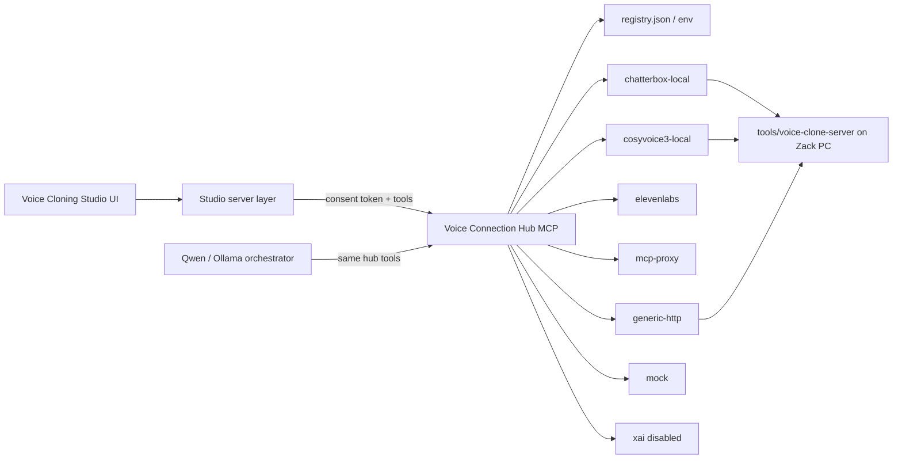

# Voice Connection Hub architecture (Adrian's Mind)

Studio never calls cloning engines directly. All create / synthesize / delete / health traffic goes through the **Voice Connection Hub** (MCP).

## Diagram

## Consent

1. Studio verifies spoken consent (STT) and stores the consent record.
2. Studio issues an HMAC consent token (`VOICE_HUB_CONSENT_SECRET`).
3. Hub `create_voice` refuses calls without a valid token + matching `consent_record_id`.

## Adapter how-to

1. Add `tools/voice-mcp-hub/adapters/<id>.ts` exporting `createAdapter(env)`.
2. Implement `health`, `listVoices`, `createVoice`, `synthesize`, `deleteVoice`.
3. Enable in `registry.json` or `VOICE_HUB_ENABLED`.
4. Pass conformance tests in `tools/voice-mcp-hub/src/hub.test.ts`.

Unsafe ids (`../`, slashes) are rejected.

## Registry

See `tools/voice-mcp-hub/registry.json`. Env overrides: `VOICE_HUB_DEFAULT_PROVIDER`, `VOICE_HUB_ENABLED`.

Default provider: **chatterbox-local**.

## Model sizing (from research 2026-11-03)

Source: `/workspace/research/voice-cloning-models-2026-11.md`

| Model | Download (practical) | VRAM | Disk | Fits 8–16 GB? | Notes |
|-------|----------------------|------|------|---------------|-------|
| Chatterbox | ~3.2 GB | ~4 GB | ~10–14 GB | Yes | MIT; PerTh watermark; default |
| Fun-CosyVoice3-0.5B | ~9.7 GB | ~8 GB | 15–20 GB | Tight at 8 | Apache-2.0; speaker profiles |
| CosyVoice2 | ~4.9 GB | ~8 GB | 12–18 GB | Borderline | Apache |
| XTTS v2 | ~2.1 GB | ~4 GB | 8–12 GB | Yes | **DQ — CPML NC** |
| F5-TTS | ~1.3 GB | 12–16 GB | 10–16 GB | VRAM heavy | **DQ — CC-BY-NC** |

Do **not** download weights on the agent box. Zack installs on his PC via `tools/voice-clone-server/`.
